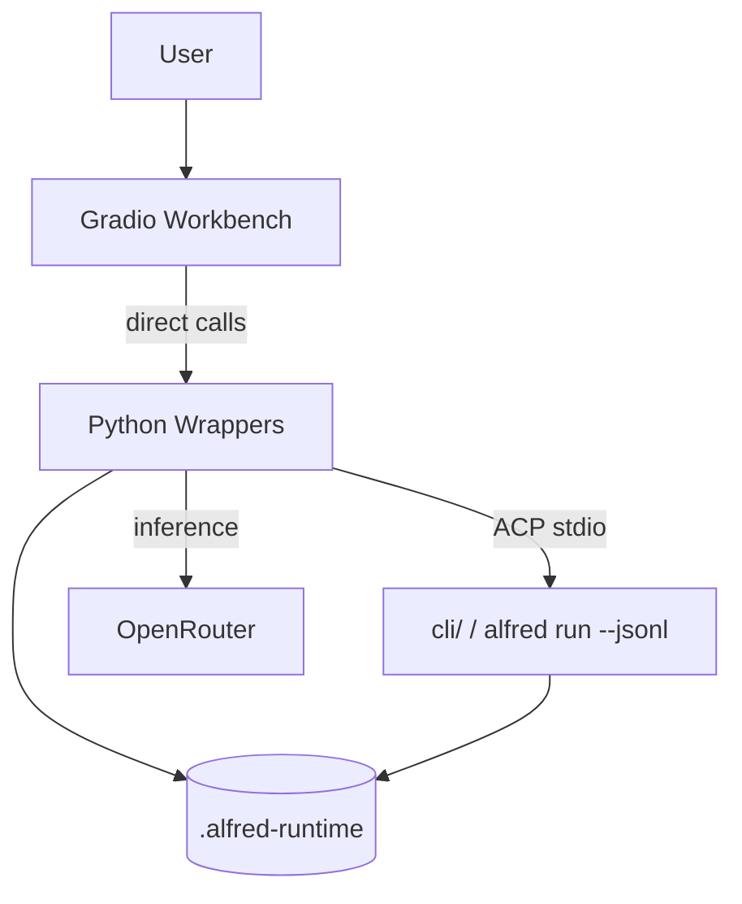
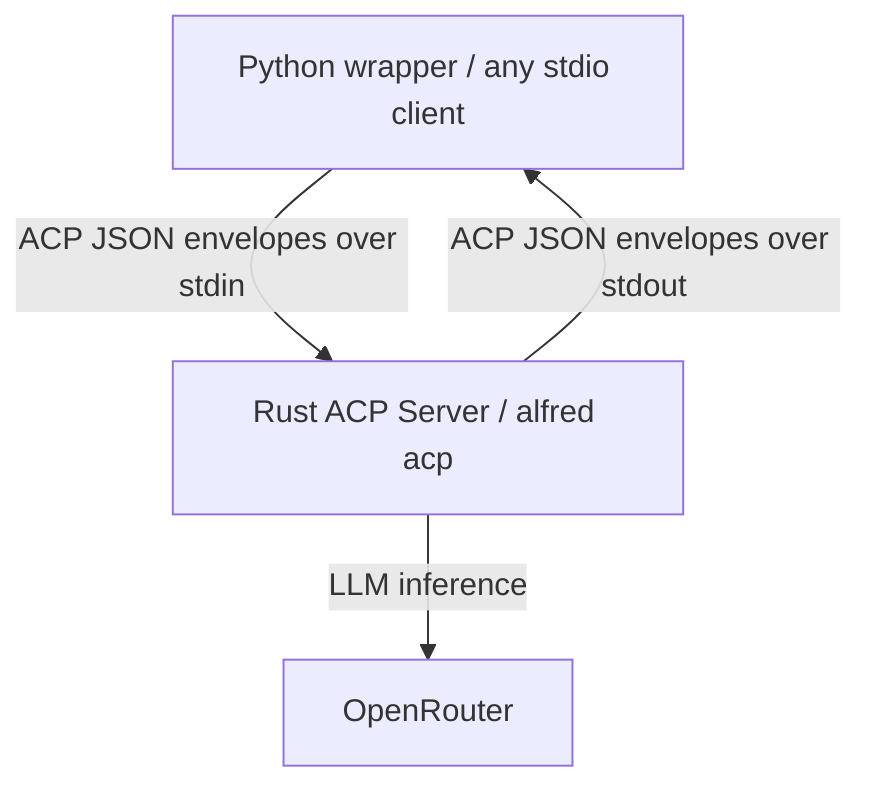

# Alfred Local Workbench Architecture

## Overview

This repository is a local-first orchestration layer around the Rust `alfred` binary in `cli/`.

- **Gradio workbench**: local UI for prompt submission and streamed output; imports Python wrappers directly
- **Python wrappers**: inference, filesystem-agent execution, and web-grounded helper scripts
- **Rust `alfred` binary**: filesystem-capable agent runtime with TUI, ACP transport, and Agent Skills discovery
- **Filesystem runtime**: session logs, artifacts, and results under `.alfred-runtime/`

## Flow

### Native Agent Bridge (ACP)



The Gradio workbench imports and calls Python wrapper functions directly.

### ACP Transport (`alfred acp`)



The `alfred acp` subcommand implements an Agent Communication Protocol (ACP) server over stdio. It reads JSON envelopes from stdin and writes event envelopes to stdout.

**Client → Server**

```
{ "type": "session.start", "session_id": "<uuid>", "cwd": "<path>" }
{ "type": "prompt.send",   "prompt": "<text>" }
{ "type": "session.cancel" }
{ "type": "session.close" }
```

**Server → Client**

```
{ "type": "meta",          "session_id": "...", "cwd": "...", "backend": "...", "transport": "acp", "version": "1" }
{ "type": "delta",         "content": "<text>" }
{ "type": "tool_request",  "name": "<tool>", "arguments": {...} }
{ "type": "tool_result",   "name": "<tool>", "output": "...", "is_error": false }
{ "type": "artifact",      "label": "...", "path": "...", "url": null }
{ "type": "done",          "result": "completed" }
{ "type": "error",         "message": "...", "exit_code": null }
```

The Python filesystem-agent wrapper launches `alfred acp`, sends the session and prompt envelopes, and persists the returned events in `.alfred-runtime/` through the same contract used by the workbench.

## Responsibilities

### Python wrapper layer (`scripts/`)

- `common.py`: session management, JSONL helpers, SSE formatting, binary resolution
- `fs_agent.py`: runs filesystem-agent requests through `alfred acp`
- `chat.py`: compatibility wrapper over the same Rust/Cersei ACP agent path
- `research.py`: web-grounded research helpers

### Rust ACP server (`cli/crates/alfred-cli/src/acp.rs`)

- Handles `alfred acp` CLI entrypoint: stdio server mode
- Session lifecycle: `session.start` → `prompt.send` → streaming events → `session.close`
- Uses the modular `cersei` crate SDK for streaming agent and tool execution
- Emits ACP-compliant JSON envelopes to stdout; diagnostics to stderr

### Rust CLI binary (`cli/`)

- `alfred` — TUI (default)
- `alfred run --jsonl --prompt <text> --session-id <id>` — scriptable agent execution (cwd and session id optional)
- `alfred acp` — ACP stdio transport used by the Python workbench bridge

## Context and Skills

The Rust agent uses Cersei's `Grep` and `CodeSearch` tools for repository search. `Grep` is
ripgrep-compatible: it supports regex, respects `.gitignore`, skips binary files, and returns
`path:line:content` matches without requiring a separate RAG index.

Each executable agent path also exposes Cersei's `Skill` tool. It discovers standard `SKILL.md`
packages from the current project, including the repository-owned `skills/` directory. The starter
skills are `codebase-research` for evidence-led repository work and `friendly-teacher` for concise,
adaptive technical explanations.

Configured MCP servers are connected at startup. Their discovered tools are available to the agent
through the permissioned `mcp_call` bridge, which routes a tool name and JSON arguments to the
owning server. Define stdio servers in `~/.config/alfred/config.toml`:

```toml
[[mcp_servers]]
name = "obsidian"
command = "obsidian"
args = ["mcp", "serve"]
```

## Environment Variables

| Variable               | Default                              | Purpose                                      |
|------------------------|--------------------------------------|----------------------------------------------|
| `ALFRED_CLI_BIN`       | auto-resolve from `cli/target/`      | Path to `alfred` binary                      |
| `ALFRED_RUNTIME_ROOT`  | `.alfred-runtime`                    | Root for all session/event storage           |
| `OPENROUTER_API_KEY`   | *(required)*                         | LLM provider key                             |
| `OPENROUTER_MODEL`     | `google/gemini-3.5-flash`            | OpenRouter model used by the Rust CLI        |
